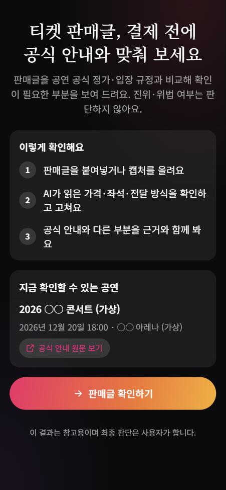
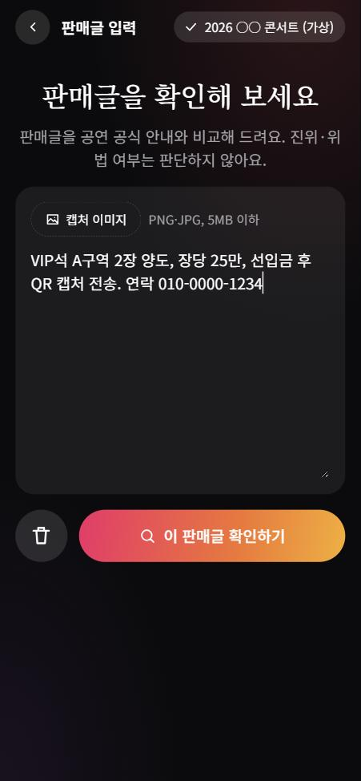
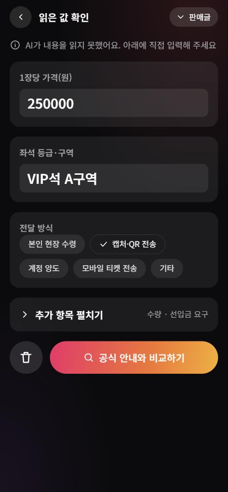
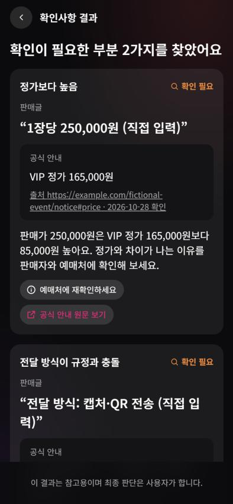
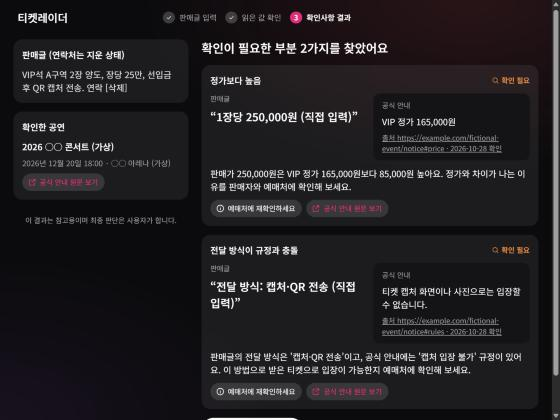
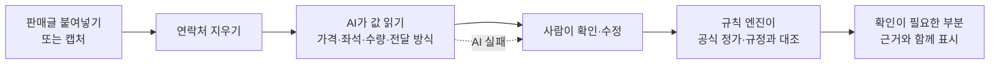

# 티켓레이더 (가칭)

**중고 공연 티켓 판매글을 결제 전에 공식 안내와 맞춰 보는 웹 서비스.**
판매글을 붙여넣거나 캡처를 올리면 AI가 가격·좌석·전달 방식을 읽고, 서버가 공연의 공식 정가·입장 규정과 **코드로** 대조해 "확인이 필요한 부분"을 근거와 함께 보여 준다. 진위나 위법 여부는 판단하지 않는다.

| | |
|---|---|
| **종류** | 반응형 웹 (모바일 390px 기준, PC 1024px 두 단 배치) |
| **배경** | 2026 AID AI-Thon 출품작, 4인 팀 "월32" |
| **스택** | Spring Boot 4 · Java 17 · JPA · MySQL / React 19 · Vite · TypeScript / Gemini API |
| **상태** | 핵심 흐름(입력 → AI 추출 → 사람 확인 → 대조 → 결과)과 관리자 화면 동작. 서버 테스트 67개, 화면 테스트 8개 통과 |

## 화면

| 홈 | 판매글 입력 | 읽은 값 확인 | 확인사항 결과 |
|---|---|---|---|
|  |  |  |  |

PC에서는 왼쪽에 판매글과 공연 정보, 오른쪽에 결과 카드를 나란히 둔다.



화면 속 공연·판매글·연락처는 모두 가상 데이터다.

## 풀려는 문제

중고 티켓을 사려는 팬은 판매글만 보고 정가보다 얼마나 비싼지, 그 전달 방식으로 실제 입장이 되는지 알기 어렵다. 공식 공지는 따로 찾아 읽어야 하고, 판매글 표현은 제각각이다.

티켓레이더는 이 대조를 대신 해 준다. 결과는 판정이 아니라 **확인할 거리**다. 카드마다 판매글 구절, 공식 안내 문장, 출처 주소, 확인 날짜를 나란히 보여 주고, 마지막 판단은 사용자에게 맡긴다.

## 동작 흐름



## 설계에서 신경 쓴 점

**1. 판단은 코드가, AI는 읽기만**
AI에게는 비정형 글에서 값을 뽑는 일만 맡겼다. 정가 초과, 전달 방식과 규정의 충돌 같은 판단은 순수 함수로 짰다. 같은 입력이면 항상 같은 결과가 나오고, 왜 그렇게 나왔는지 설명할 수 있다. 기준값(정가 대비 1.5배, 수량 4장)은 코드가 아니라 설정 파일에 둔다.
→ [`RuleEngine.java`](server/src/main/java/com/wol32/ticketradar/check/RuleEngine.java), [`RuleEngineTest.java`](server/src/test/java/com/wol32/ticketradar/check/RuleEngineTest.java)

**2. AI가 실패해도 끝까지 동작**
AI 오류, 시간 초과, 형식이 깨진 답은 오류로 처리하지 않는다. 빈 값과 `aiStatus: "fallback"`을 돌려주고 화면은 직접 입력 폼을 연다. 발표장 인터넷이 끊겨도 나머지 흐름은 그대로 돈다.
→ [`ExtractService.java`](server/src/main/java/com/wol32/ticketradar/extract/ExtractService.java)

**3. 개인정보는 남기지 않는다**
판매글 원문, 캡처, 검사 결과를 DB·디스크·로그 어디에도 저장하지 않는다. 글은 AI에 보내기 전에 전화번호·계좌·메신저 아이디·오픈채팅 주소를 `[삭제]`로 바꾸고, AI가 돌려준 구절도 한 번 더 지운다.
→ [`ContactMasker.java`](server/src/main/java/com/wol32/ticketradar/extract/ContactMasker.java)

**4. 화면에서 막은 값도 서버가 다시 확인**
이미지는 확장자가 아니라 파일 앞부분 바이트로 PNG/JPG를 판별한다. 관리자 API는 비밀번호를 길이와 무관한 시간으로 비교하고, 비밀번호가 설정되지 않으면 아예 열리지 않는다. 모든 응답은 `{ ok, data, error }` 한 모양이고, 오류에는 사용자용 한국어 문구만 담는다.
→ [`AdminAuthInterceptor.java`](server/src/main/java/com/wol32/ticketradar/admin/AdminAuthInterceptor.java), [`ApiExceptionHandler.java`](server/src/main/java/com/wol32/ticketradar/common/ApiExceptionHandler.java)

**5. AI 공급자를 갈아 끼울 수 있게**
추출 부품은 `Extractor` 자리 하나로 두고 공급자를 환경 변수로 고른다. 1차는 Gemini 무료 티어이고, 키가 없으면 자동으로 직접 입력 흐름이 된다. 무료 한도를 넘지 않도록 접속별·전체 분당 호출 수를 서버가 제한한다.
→ [`GeminiExtractor.java`](server/src/main/java/com/wol32/ticketradar/extract/GeminiExtractor.java), [아키텍처 문서 ADR 5](docs/architecture-ticket-radar.md)

**6. 단정하지 않는 문구**
결과의 이름은 항상 "확인이 필요한 부분"이다. 법적 판단을 단정하는 단어와 "안전하다"는 표현은 화면·템플릿·코드 주석 어디에도 쓰지 않고, 자동 테스트가 이를 검사한다.

## 검증

| 무엇을 | 어떻게 | 결과 |
|---|---|---|
| 정상 양도 글(정가 이하 1장) | 자동 테스트 | 확인사항 0건 |
| 시연 글(정가 1.5배 + 선입금 + QR 캡처) | 자동 테스트 | 정확히 3건, 심각도 순 |
| 기준값 변경 | 자동 테스트 | 결과가 따라 바뀜 |
| 같은 입력 두 번 | 자동 테스트 | 완전히 같은 결과 |
| AI 없이 완주 | 브라우저에서 직접 | 입력 → 직접 입력 → 결과까지 동작 |
| 관리자 API에 비밀번호 없이 요청 | 실제 요청 | 401 |
| 잘못된 값 | 실제 요청 | 400과 칸별 한국어 이유 |
| 일부러 낸 오류 | 실제 요청 | 내부 경로·테이블 이름 없이 문구만 |
| 실제 AI 추출 | 가상 글 3건 × 2회, 가상 캡처 2회 | 8회 모두 값 일치, 응답에 연락처 없음 |

코드를 쓴 뒤에는 작성자와 다른 검토자(별도 AI 에이전트)에게 리뷰를 맡겼다. 그 과정에서 찾아 고친 것 중 대표적인 세 가지:

- 관리자 주소에 `;`를 끼워 넣으면 인증을 건너뛰던 문제 → 컨트롤러와 같은 경로 해석을 쓰는 방식으로 교체
- 배율을 반올림한 뒤 비교해 1.497배가 1.5배로 판정되던 문제 → 원래 값으로 판단
- AI가 돌려준 구절에 캡처 속 연락처가 섞여 나올 수 있던 문제 → 응답 전에 다시 지움

**아직 하지 않은 것**: 가상 판매글 10건으로 일치율을 재는 검증표(목표 10건 중 8건), 라이트 모드, Should 범위(제보 근거 정리, 같은 연락처 반복 표시).

## 문서

코드보다 문서를 먼저 정하고 그 범위 안에서만 만들었다.

| 문서 | 내용 |
|---|---|
| [기획서](docs/prd-ticket-radar.md) | 문제, 목표 숫자, 범위(만들 것·안 만들 것), 위험 |
| [아키텍처](docs/architecture-ticket-radar.md) | 구성도, 데이터 목록, API 목록, 결정 기록(ADR) 5건 |
| [API 계약서](docs/api-contract.md) | API 5개의 요청·응답 모양과 서버가 확인할 것 |
| [화면 명세표](docs/screen-spec-ticket-radar.md) | 화면별 목적, 네 가지 상태(빈·로딩·오류·정상), 넣지 않을 것 |
| [디자인 토큰](docs/design-tokens.md) | 색·글꼴·여백 값과 부품 규칙 |
| [개발 일지](docs/dev-log.md) | 단계별로 한 일, 막힌 점, 알게 된 것 |

## 실행

준비물: Java 17 이상, Node 22.18 이상, MySQL 8. Maven은 설치하지 않아도 된다(저장소의 `mvnw` 사용).

1. `.env.example`을 복사해 `.env`를 만들고 `DB_PASSWORD`를 채운다. AI 추출까지 쓰려면 `GEMINI_API_KEY`도 채운다(비워 두면 직접 입력 흐름으로 동작).
2. 아래 한 줄로 화면을 빌드하고 서버를 띄운다.

```powershell
powershell -ExecutionPolicy Bypass -File scripts\start.ps1
```

3. 브라우저에서 http://localhost:8080 을 연다. 관리자 화면은 `/#/admin`(아이디 `admin`, 비밀번호는 `.env`의 `ADMIN_PASSWORD`).

테스트:

```powershell
cd server; .\mvnw.cmd test
```

```powershell
cd client; npm test
```

서버 테스트는 메모리 DB(H2)로 돌아가서 MySQL이 없어도 된다.

<details>
<summary><b>환경 변수, 문제 해결, API 직접 불러 보기</b></summary>

### `.env` 칸

| 칸 | 뜻 |
|---|---|
| `DB_HOST` `DB_PORT` `DB_NAME` `DB_USER` `DB_PASSWORD` | 로컬 MySQL 접속 정보. 기본 `127.0.0.1:3306`, DB 이름 `ticket_radar`(없으면 서버가 만든다) |
| `SERVER_PORT` | 서버 포트. 기본 8080 |
| `ADMIN_PASSWORD` | 관리자 화면 비밀번호. 비워 두면 관리자 API가 닫힌다 |
| `AI_PROVIDER` `AI_MODEL` `GEMINI_API_KEY` | AI 추출 공급자(`none`/`gemini`), 모델 코드(예: `gemini-3.5-flash-lite`), 키 |

### MySQL이 꺼져 있으면

서버가 뜨지 않고 바로 종료된다. 로그에 아래 줄이 보이면 MySQL이 꺼진 것이다.

```
Communications link failure ... Connection refused
Unable to determine Dialect without JDBC metadata
```

관리자 PowerShell에서 `net start MySQL80`을 실행한 뒤 다시 띄운다. `Access denied for user`가 나오면 `.env`의 `DB_PASSWORD`를 확인한다.

### 화면을 고치면서 볼 때

```powershell
cd client; npm install; npm run dev
```

저장하면 바로 반영된다. `/api` 요청은 Vite가 8080으로 넘겨 준다.

### API 직접 불러 보기

```powershell
Invoke-RestMethod http://localhost:8080/api/event | ConvertTo-Json -Depth 5
```

```powershell
Invoke-RestMethod -Method Post -ContentType "application/json; charset=utf-8" -Uri http://localhost:8080/api/check -Body '{"eventId":1,"pricePerTicket":250000,"seat":"VIP석 A구역","quantity":2,"deliveryMethod":"CAPTURE_QR","prepaymentRequired":true}' | ConvertTo-Json -Depth 5
```

```powershell
curl.exe -s -F "eventId=1" -F "text=VIP석 A구역 2장 양도, 장당 25만, 선입금 후 QR 캡처 전송" http://localhost:8080/api/extract
```

실제 Gemini를 한 번 불러 보는 테스트는 키가 환경 변수에 있을 때만 돈다.

```
GEMINI_API_KEY=... AI_MODEL=gemini-3.5-flash-lite ./mvnw test -Dtest=GeminiLiveSmokeTest
```

</details>

## 폴더

```
server/    Spring Boot. Controller / Service / Repository 세 층
  check/     규칙 엔진 (대조·확인사항 계산)
  extract/   AI 추출, 연락처 지우기, 이미지 검사, 호출 수 제한
  event/     공연·정가표·규정 데이터와 관리자 API
  admin/     관리자 인증
client/    React + Vite + TypeScript. 화면 5개와 공통 부품
docs/      기획서, 아키텍처, API 계약서, 화면 명세, 디자인 토큰, 개발 일지
scripts/   실행 스크립트
```

## 만든 방식과 참고한 것

- **AI와 함께 개발했다.** 사람이 범위·구조·규칙을 문서로 먼저 정하고, 코드 작성과 리뷰에 AI(Claude Code)를 썼다. AI에게 준 규칙은 [`CLAUDE.md`](CLAUDE.md)에 그대로 있다. 테스트를 먼저 쓰고, 실제 요청을 보내 확인한 뒤에만 완료로 쳤다.
- **화면 분위기는 음악 앱 Suno를 참고했다.** 어두운 바탕, 알약 모양 버튼, 카드 배치를 참고했고 참고한 점은 [`docs/suno-ui-reference.md`](docs/suno-ui-reference.md)에 적어 두었다. 화면 구성·문구·기능·코드는 직접 설계하고 만들었으며 Suno의 이미지나 코드는 쓰지 않았다.
- 테스트와 시연 데이터는 전부 가상이다. 실제 사람의 글·연락처·계정을 쓰지 않았다.
